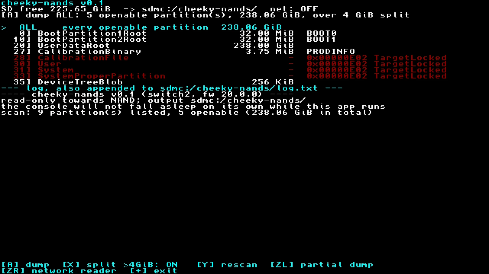

# cheeky-nands (with the lads)

Switch 2 homebrew to read NAND partitions and dump them to an SD card or over network to a PC.



^ 28, 30, 31, 33 not working on Switch 2 is normal and expected, and you'll be banned from the org if you complain about it in issues (if you have a tested way to read them that's fine to open an issue about, ofc).

## Running it

Copy the NRO for your console to the SD card under /switch/ and start it from the homebrew
menu.

### What to dump

On the Switch 2, 0 (BootPartition1Root, LUN0), 10 (BootPartition2Root, LUN1) and UserDataRoot (20) could be used to reconstruct the UFS contents after a brick. UserDataRoot contains the encrypted contents, the rest are all decrypted.

Beware: UserDataRoot is 256GB, and over wifi it'll take 2-6 hours to dump it, and ~2 more to validate it. Over a gigabit ethernet connection with the dock (make sure you're set up with 90dns or whatever on the wired network settings too btw), it'll be closer to an hour instead. If it'll take too long, consider leaving it overnight. Plug it to power or something. Make sure you have enough free space beforehand. If dumping to a microsd express, it should be about as fast as the gigabit dump at around an hour.

[See this Switchbrew article for background](https://switchbrew.org/wiki/Switch_2:_Flash_Filesystem).

Before anyone tries to make a big deal about PRODINFO again: It's all just [calibration data](https://switchbrew.org/wiki/Calibration) with not even any partly-certificates within (on switch 2, they're reportedly on PRODINFOF). This is not the first time someone dumps it, and won't be the last.

#### Remark on space and compression

Unused NAND sections appear to be zeroes on disk. This means that if you haven't utilized too much of your nand, it should compress decently well afterwards, at least just down to the used space of your switch 2 nand.

I'm not sure if removing anything from your nand zeroes it back out again, so how much it'll compress to may instead represent the most you've ever stored on your NAND. If anyone tests this, let me know. I'm not willing to delete all the games I downloaded before 23.5.0 dropped.

This tool doesn't come with any built-in compression, compress it yourself afterwards :) I can recommend [zstd](https://en.wikipedia.org/wiki/Zstd) but really, zip, rar, 7z etc will work too.

### How to dump

- **On the console**: pick a partition and dump it to `sdmc:/cheeky-nands/`.
- **Over the network**: turn on the network reader, then pull partition bytes
  with `net_pull.py` from a PC. You probably want to check it against
  the console afterwards too.

### Pulling over the network

`ZR` turns the console into a TCP server on port 28900.

The included `net_pull.py` can be used with base python3 to interact with it. Here are some example commands:

```
python3 net_pull.py --host [your.console.ip.here] ping
python3 net_pull.py --host [your.console.ip.here] list
python3 net_pull.py --host [your.console.ip.here] list --out partitions.txt
python3 net_pull.py --host [your.console.ip.here] read 0 0 end BootPartition1Root.bin
python3 net_pull.py --host [your.console.ip.here] read 10 0 end BootPartition2Root.bin
python3 net_pull.py --host [your.console.ip.here] read 20 0 end UserDataRoot.bin
```

You can and should also validate a NAND backup like so:

```
python3 net_pull.py verify 20 0 end UserDataRoot.bin
```

This will generate and compare hashes of chunks on both console and PC, and if any parts differ, it'll compare them byte by byte. You should expect some minor changes between dump and validate, as the system is running while we're doing this. If you see major differences, dump again :(

## Building

- https://github.com/ouncebrew/ounce-devkit -> `docker build -t ounce-devkit .`
- `./build.sh switch2`

## Thanks to

- SciresM, who pointed out this was possible and detailed how in reswitched a few weeks back, [jump link](https://discord.com/channels/269333940928512010/1356976144418865384/1567965047693512736)
- Switchbrew, which remains a very useful reference for all this.

## llm remark

not happy about this being yet another llm project in this scene. once someone makes one by hand that has feature parity (dumping these partitions to SD or over network) I'll deprecate this.
